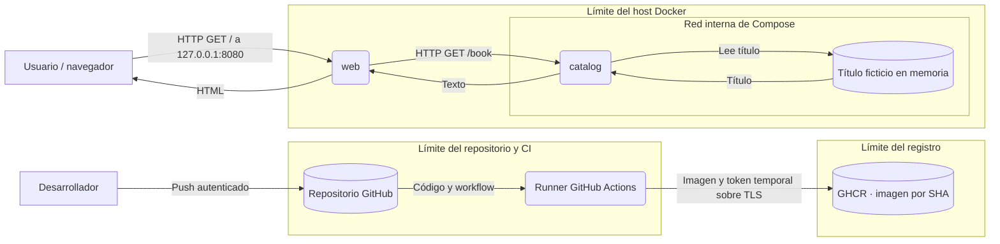

# DFD y amenazas STRIDE

| STRIDE | Amenaza y riesgo | Control aplicado o tratamiento propuesto |
|---|---|---|
| S · Suplantación | Un proceso dentro de una red comprometida suplanta al catálogo. Medio. | Red interna y URL fija. Para producción, autenticar el servicio. |
| T · Manipulación | Un cambio no revisado altera el workflow o la imagen publicada. Alto. | Etiqueta por commit y transferencia del mismo artefacto. Propuesta: proteger main y verificar el digest al desplegar. |
| R · Repudio | Una publicación no puede atribuirse a un cambio. Medio. | Actions registra ejecución, actor y commit. La etiqueta vincula imagen y commit. |
| I · Divulgación | Un servicio queda visible para terceros. Medio. | Solo web se publica en loopback y el catálogo usa datos ficticios. Propuesta: TLS y autenticación si se expone externamente. |
| D · Denegación de servicio | El catálogo no responde y bloquea consultas. Medio. | Timeout de dos segundos y respuesta 503. Propuesta: límites de concurrencia y tasa. |
| E · Elevación de privilegios | Un proceso comprometido obtiene permisos amplios. Alto. | Contenedores sin root y escritura en Packages restringida a publish. Propuesta: fijar dependencias por digest y limitar capacidades. |
